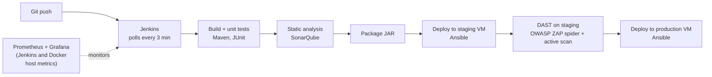

# Spring PetClinic DevSecOps Pipeline

A self-hosted CI/CD pipeline that builds, tests, scans, and deploys the Spring PetClinic app to staging and production VMs, with static analysis (SonarQube), dynamic security testing (OWASP ZAP) against staging before production, and Prometheus/Grafana monitoring. One script brings up the whole environment; another tears it down.

**Course:** 17-636 DevOps, Carnegie Mellon University, Fall 2025  
**Team:** Karthik Chakkalakal, Sarvesh Navare, Srushti Venkatesh Reddy

All of the pipeline and infrastructure work lives in [`infra/`](infra/). The application itself is the upstream [Spring PetClinic](https://github.com/spring-projects/spring-petclinic) sample app (see [About the base application](#about-the-base-application)).

## Pipeline



| Stage | What happens |
|---|---|
| Build | `mvn clean test`; JUnit results published in Jenkins |
| Static analysis | SonarQube scan using a token generated at setup and stored as a Jenkins credential |
| Package | Builds the JAR and archives it as a Jenkins artifact |
| Staging deployment | Ansible copies the JAR to the staging VM and runs it as a systemd service |
| Security analysis | Waits for staging to come up, then runs a ZAP spider and active scan against it through the ZAP API; the HTML report is archived and published in Jenkins |
| Production deployment | Same Ansible playbook, targeting the production VM |

## Highlights

- **One-command setup.** `infra/auto_script.sh` starts the Docker containers (Jenkins, SonarQube, OWASP ZAP, Prometheus, Grafana, Node Exporter), creates the staging and production VMs with Vagrant, generates a SonarQube token through its API, and hands credentials to Jenkins. `infra/cleanup_script.sh` removes the containers, volumes, and VMs.
- **Jenkins configured as code.** Jenkins Configuration as Code (JCasC) and Groovy init scripts create the admin user, the SonarQube connection, the credentials, and the pipeline job, so the pipeline is ready to run at first login. Anonymous access is disabled.
- **Credentials kept out of the pipeline code.** The SonarQube token, ZAP API key, and per-VM SSH keys are injected as environment variables at startup, stored in the Jenkins credential store, and unset from the shell afterward. The Jenkinsfile only references credential IDs. The setup script ships with default values for the Jenkins password and ZAP API key so it runs out of the box; they are meant to be overridden.
- **Hardened target VMs.** Both Ubuntu 24.04 VMs disable SSH password authentication, and Ansible runs the app under a dedicated non-root user as a systemd service.
- **Dynamic testing before production.** Every build is scanned by ZAP on staging before it reaches production. The scan produces a report rather than a gate: findings do not automatically block the production deployment.
- **Monitoring.** Prometheus scrapes Jenkins metrics and host metrics from Node Exporter on the Docker host; Grafana ships with pre-provisioned dashboards. The staging and production VMs are not monitored.
- **Runs on ARM and x86.** The Vagrant box supports both architectures. It was developed on Apple Silicon (macOS) and also run on x86 (Windows 11), with less testing there.

## Running it

Prerequisites, setup steps, service URLs, and cleanup are in [`infra/README.md`](infra/README.md). In short:

```bash
cd infra
./auto_script.sh      # bring everything up
./cleanup_script.sh   # tear everything down
```

## Contributions

**Karthik Chakkalakal** ([@Drakey-504](https://github.com/Drakey-504))
- Wrote the Jenkins pipeline (`Jenkinsfile`), including the ZAP scanning stage and the staging and production deployment stages
- Built the staging and production VMs with Vagrant, including SSH hardening, and the Ansible deployment playbook
- Set up Jenkins configuration as code and the SSH credential wiring between Jenkins and the VMs
- Built the custom ZAP container and automated SonarQube token generation
- Wrote the setup and cleanup scripts and most of the setup documentation

**Sarvesh Navare** ([@snavare-andrew](https://github.com/snavare-andrew))
- Built the Docker Compose stack and the Prometheus and Grafana monitoring, including the dashboards
- Wrote the Groovy init script that loads the SonarQube token into Jenkins, and fixed pipeline build issues
- Hosted the original team repository ([snavare-andrew/spring-petclinic-devops](https://github.com/snavare-andrew/spring-petclinic-devops))

**Srushti Venkatesh Reddy**
- Set up the initial Jenkins and SonarQube containers and the Jenkins plugin list

## Stack

Jenkins (JCasC, Blue Ocean) · SonarQube · OWASP ZAP · Docker Compose · Vagrant · VirtualBox · Ansible · Prometheus · Grafana · Node Exporter · Maven · Bash

## About the base application

This repository is a fork of [spring-projects/spring-petclinic](https://github.com/spring-projects/spring-petclinic). The application code (`src/`), its build files, the `k8s/` manifests, and the `.github/workflows` builds come from the upstream project and its contributors, under the Apache 2.0 license ([`LICENSE.txt`](LICENSE.txt)). They are not part of this course project. See the upstream repository for details on the application itself.
